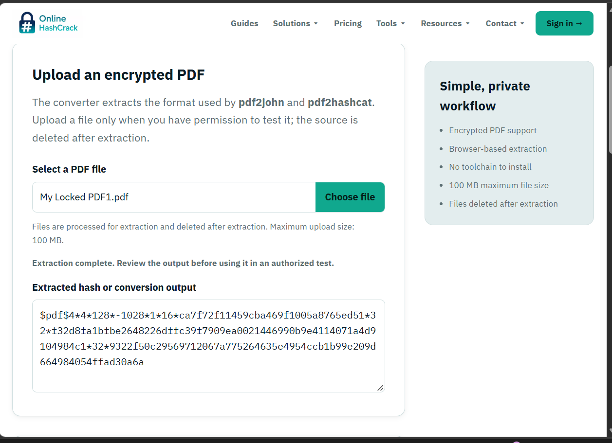
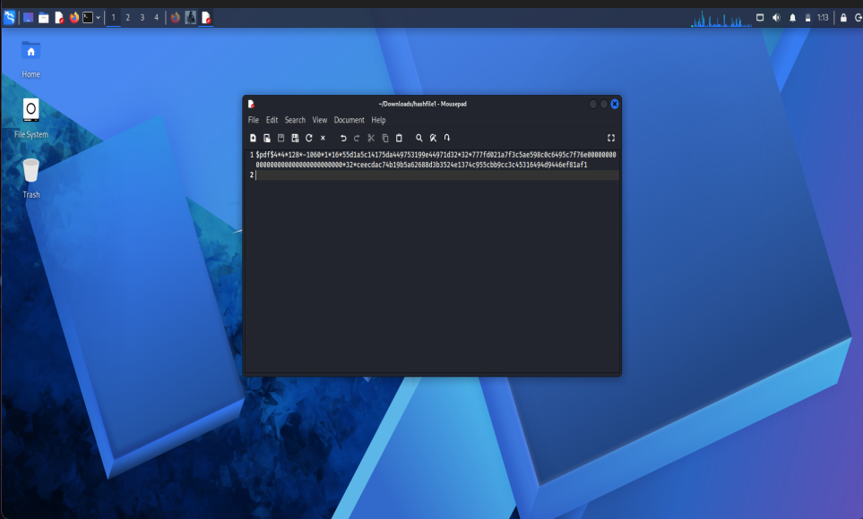
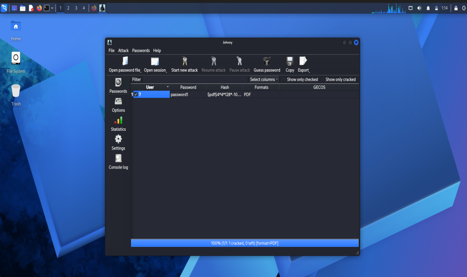
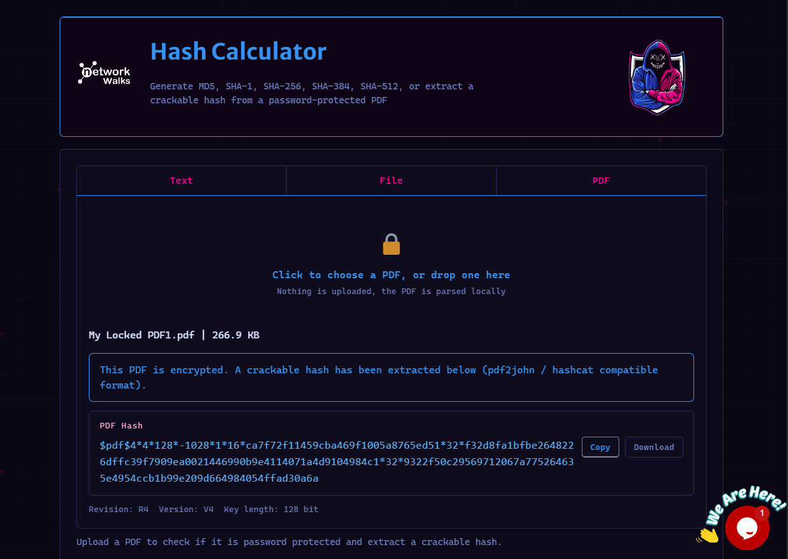
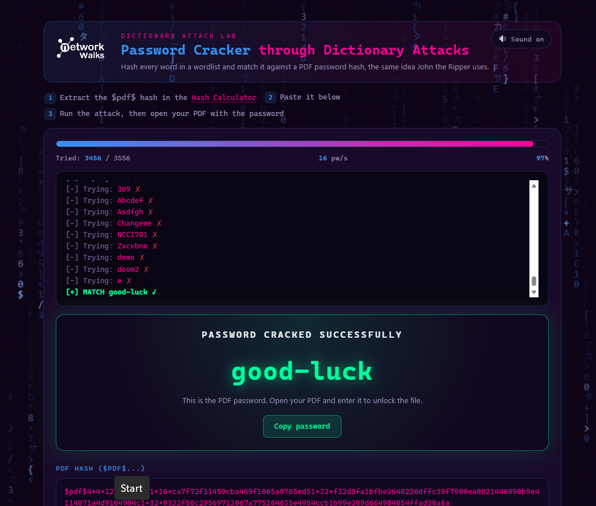
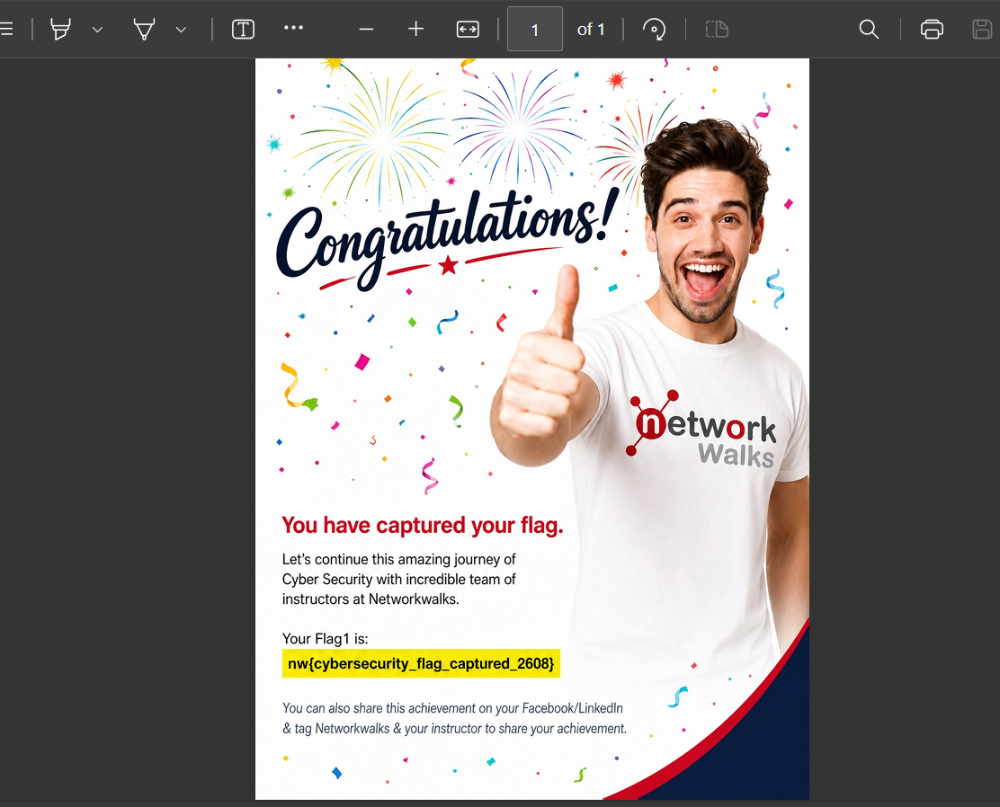
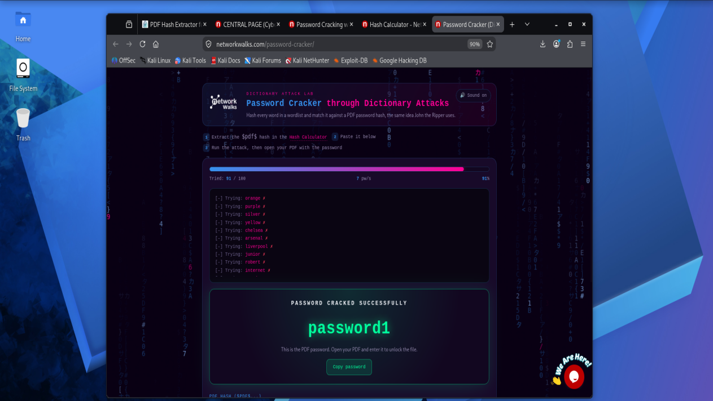
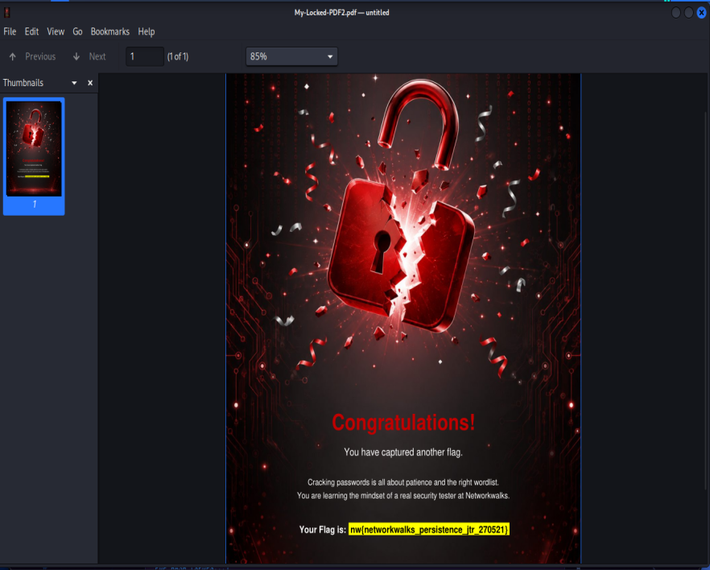
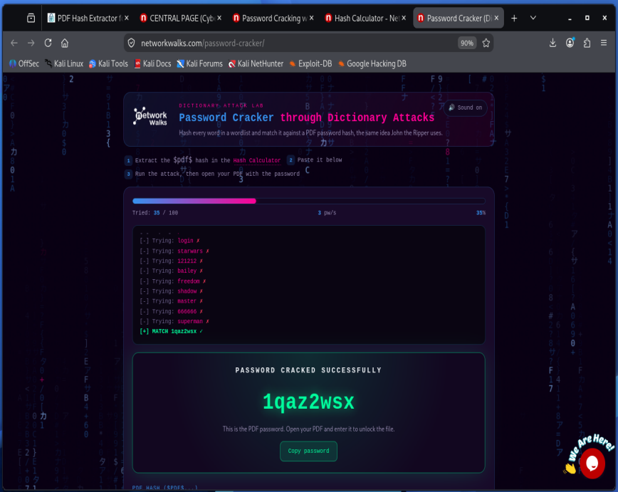

# PASSWORD AUDITING & RECOVERY REPORT

## WEEK 3 \| PROJECT MODULE

# PDF PASSWORD CRACKING

### USING JOHN THE RIPPER & NETWORKWALKS WEB-BASED TOOLS

**A practical report on extracting PDF password hashes and recovering
passwords with dictionary-based tools.**

------------------------------------------------------------------------

## 📌 Project Overview

| Field                | Details                                                              |
|:---------------------|:---------------------------------------------------------------------|
| **Project**          | Week 3 – Password Cracking                                           |
| **Project Title**    | PDF Password Cracking Using John the Ripper & NetworkWalks Web Tools |
| **Author**           | Singari Laharika                                                              |
| **Program**          | NetworkWalks Cybersecurity Project                                   |
| **Target**           | Three password-protected training PDF files                          |
| **Operating System** | Kali Linux                                                           |
| **Web Environment**  | Browser                                                              |
| **Focus**            | PDF hash extraction and password recovery                            |

This project demonstrates how password-protected PDF files can be
audited using dictionary-based password recovery techniques. I worked
with John the Ripper through its Johnny graphical interface and
NetworkWalks’ online Hash Calculator and Password Cracker.

The practical work covers two modules:

- **Module 1 – John the Ripper (Johnny GUI):** Loading an extracted PDF
  hash into Johnny and checking password candidates using a wordlist.
- **Module 2 – NetworkWalks Web Tools:** Extracting a PDF hash in the
  browser and submitting it to the online Password Cracker.

## 🎯 Objectives

- Understand the basics of PDF password protection.
- Learn how password hashes are extracted from protected PDF files.
- Understand dictionary attacks and wordlists.
- Explore John the Ripper and its Johnny GUI.
- Use NetworkWalks’ online Hash Calculator and Password Cracker.
- Observe cracking progress and identify successful password matches.
- Verify recovered passwords by opening the corresponding PDFs.
- Understand why strong and unique passwords are important.

------------------------------------------------------------------------

# 🧩 MODULE 1 – PDF Password Auditing Using John the Ripper

## 1. Introduction

John the Ripper is a password-auditing tool that checks candidate
passwords against password hashes. In this module, I used Johnny, its
graphical interface, in Kali Linux to load an extracted PDF hash and
view the recovery result.

## 2. Tools Used

| Tool                   | Purpose                                             |
|:-----------------------|:----------------------------------------------------|
| **Kali Linux**         | Testing environment                                 |
| **John the Ripper**    | Password auditing tool                              |
| **Johnny GUI**         | Graphical interface for John the Ripper             |
| **PDF Hash Extractor** | Extracts a hash from a protected PDF                |
| **Wordlist**           | Provides candidate passwords                        |
| **PDF Viewer**         | Checks whether the recovered password opens the PDF |

## 3. Methodology

1.  **Select the training PDF:** Used the password-protected PDF
    supplied for the exercise.
2.  **Extract the hash:** Used a PDF hash extraction tool to obtain a
    `$pdf$`-format hash.
3.  **Save the hash:** Saved the extracted hash in a text file in Kali
    Linux.
4.  **Open Johnny:** Launched Johnny and loaded the saved hash file.
5.  **Run the audit:** Started the dictionary-based password check and
    monitored the result.
6.  **Check the result:** Confirmed the successful password match shown
    in Johnny.

## 4. Result

The Johnny screenshot shows a successful password match:

| Parameter                    | Result                  |
|:-----------------------------|:------------------------|
| **Tool**                     | Johnny GUI              |
| **Recovered password shown** | `password1`             |
| **Status**                   | ✅ Password match found |

**Evidence:**

<figure>

<figcaption aria-hidden="true">Extracted PDF hash using online hash crack tool
</figcaption>
</figure>

<figure>

<figcaption aria-hidden="true">Extracted PDF hash saved in
Mousepad</figcaption>
</figure>

<figure>

<figcaption aria-hidden="true">Johnny GUI showing the recovered
password</figcaption>
</figure>

------------------------------------------------------------------------

# 🌐 MODULE 2 – NetworkWalks Web-Based Password Cracking Tools

## 1. Introduction

In this module, I used NetworkWalks’ browser-based tools to extract PDF
password hashes and check them against a built-in wordlist.

The module uses two tools:

1.  **NetworkWalks Hash Calculator** – extracts a crackable hash from a
    password-protected PDF.
2.  **NetworkWalks Password Cracker** – checks candidate passwords
    against the extracted hash.

## 2. Tools Used

| Tool                              | Purpose                                      |
|:----------------------------------|:---------------------------------------------|
| **NetworkWalks Hash Calculator**  | Extracts the PDF hash                        |
| **NetworkWalks Password Cracker** | Performs the dictionary-based password check |
| **Web Browser**                   | Opens the online tools                       |
| **PDF Viewer**                    | Verifies the recovered password              |

**Tools used:** - [NetworkWalks Hash
Calculator](https://networkwalks.com/hash-calculator/) - [NetworkWalks
Password Cracker](https://networkwalks.com/password-cracker/)

## 3. Methodology

1.  **Open the Hash Calculator:** Navigated to the NetworkWalks Hash
    Calculator and selected the PDF option.
2.  **Choose the PDF:** Selected the password-protected training PDF.
3.  **Extract the hash:** The tool processed the PDF in the browser and
    displayed a hash in `$pdf$` format.
4.  **Copy the hash:** Copied the extracted hash from the result area.
5.  **Open the Password Cracker:** Navigated to the NetworkWalks
    Password Cracker.
6.  **Submit the hash:** Pasted the extracted hash into the input field
    and started the check.
7.  **Review the result:** Monitored the candidate attempts and progress
    until the tool displayed a password match.
8.  **Verify the PDF:** Used the recovered password to open the
    corresponding PDF.

## 4. Results – PDF Password Recovery

All three PDFs shown in the web-tool screenshots produced successful
password matches.

### PDF 1 – My Locked PDF1.pdf

| Parameter              | Result                                 |
|:-----------------------|:---------------------------------------|
| **Hash extraction**    | ✅ Successful                          |
| **Recovered password** | `good-luck`                            |
| **Password check**     | ✅ Successful                          |
| **Captured flag**      | `nw{cybersecurity_flag_captured_2608}` |

<figure>

<figcaption aria-hidden="true">Hash extracted using NetworkWalks Hash
Calculator</figcaption>
</figure>

<figure>

<figcaption aria-hidden="true">NetworkWalks Password Cracker showing the
PDF 1 match</figcaption>
</figure>

<figure>

<figcaption aria-hidden="true">PDF 1 flag</figcaption>
</figure>

### PDF 2 – My Locked PDF2.pdf

| Parameter              | Result                                    |
|:-----------------------|:------------------------------------------|
| **Recovered password** | `password1`                               |
| **Password check**     | ✅ Successful                             |
| **Captured flag**      | `nw{networkwalks_persistence_jtr_270521}` |

<figure>

<figcaption aria-hidden="true">NetworkWalks Password Cracker showing the
PDF 2 match</figcaption>
</figure>

<figure>

<figcaption aria-hidden="true">PDF 2 flag</figcaption>
</figure>

### PDF 3 – My Locked PDF3.pdf

| Parameter              | Result                           |
|:-----------------------|:---------------------------------|
| **Recovered password** | `1qaz2wsx`                       |
| **Password check**     | ✅ Successful                    |
| **Captured flag**      | `nw{networkwalks_flag_260821_1}` |

<figure>

<figcaption aria-hidden="true">NetworkWalks Password Cracker showing the
PDF 3 match</figcaption>
</figure>

<figure>

<figcaption aria-hidden="true">PDF 3 flag</figcaption>
</figure>

------------------------------------------------------------------------

# 🏆 Overall Results

| PDF Document       | Recovered Password | Result        |
|:-------------------|:-------------------|:--------------|
| My Locked PDF1.pdf | `good-luck`        | ✅ Successful |
| My Locked PDF2.pdf | `password1`        | ✅ Successful |
| My Locked PDF3.pdf | `1qaz2wsx`         | ✅ Successful |

## ⚖️ Comparison of Both Modules

| Feature               | Module 1 – John the Ripper | Module 2 – NetworkWalks Web Tools |
|:----------------------|:---------------------------|:----------------------------------|
| **Environment**       | Kali Linux                 | Web browser                       |
| **Hash extraction**   | PDF hash extractor         | NetworkWalks Hash Calculator      |
| **Password auditing** | John the Ripper            | NetworkWalks Password Cracker     |
| **Interface**         | Johnny GUI                 | Web interface                     |
| **Candidate source**  | Wordlist                   | Built-in wordlist                 |
| **Result evidence**   | Johnny screenshot          | Password Cracker screenshots      |

## 📚 Key Concepts Learned

| Concept               | What I Learned                                                          |
|:----------------------|:------------------------------------------------------------------------|
| **PDF Hash**          | A representation of PDF password-protection data used by auditing tools |
| **Hash Extraction**   | Obtaining a hash from a password-protected PDF                          |
| **Dictionary Attack** | Checking password candidates from a wordlist                            |
| **Wordlist**          | A collection of candidate passwords                                     |
| **John the Ripper**   | A tool used for password auditing                                       |
| **Johnny GUI**        | A graphical interface for John the Ripper                               |
| **Hash Matching**     | Finding a candidate that matches the extracted hash                     |
| **PDF Protection**    | Understanding password protection and the need for strong passwords     |

## 🔐 Security Recommendations

- Use long, unique passwords for protected documents.
- Avoid common passwords and predictable patterns.
- Do not reuse passwords across documents or accounts.
- Use a password manager to create and store strong passwords.
- Choose strong encryption settings when protecting PDF files.
- Keep sensitive documents and passwords secure.
- Only perform password auditing with permission.

------------------------------------------------------------------------

# 🏁 Conclusion

I completed the Week 3 PDF password-cracking exercise using John the
Ripper with Johnny GUI and NetworkWalks’ browser-based tools. I learned
how to extract PDF hashes, understand dictionary-based password
checking, and review successful password matches.

The NetworkWalks Password Cracker screenshots show successful matches
for all three training PDFs. The exercise helped me understand the
importance of strong passwords and responsible password auditing.

------------------------------------------------------------------------

## ⚠️ Ethical Disclaimer

This work was completed for educational purposes using designated
training files. Password-auditing tools must only be used on files and
systems that you own or have explicit permission to test.

------------------------------------------------------------------------

## 🛠️ Technologies & Tools

- Kali Linux
- John the Ripper
- Johnny GUI
- NetworkWalks Hash Calculator
- NetworkWalks Password Cracker
- PDF Hash Extraction
- Dictionary-Based Password Auditing
- Wordlists

------------------------------------------------------------------------

## 👤 Author

**Singari Laharika**\
B.Tech Student | Cybersecurity Intern, Networkwalks (Batch B084N) 

GitHub: [https://github.com/Singari-Laharika/](https://github.com/Singari-Laharika/)\
LinkedIn: [https://www.linkedin.com/in/singari-laharika/](https://www.linkedin.com/in/singari-laharika/)

------------------------------------------------------------------------

## 📌 Project Information

**Program:** NetworkWalks Cybersecurity  
**Week:** 03  
**Project:** PDF Password Cracking  
**Repository:** GitHub
